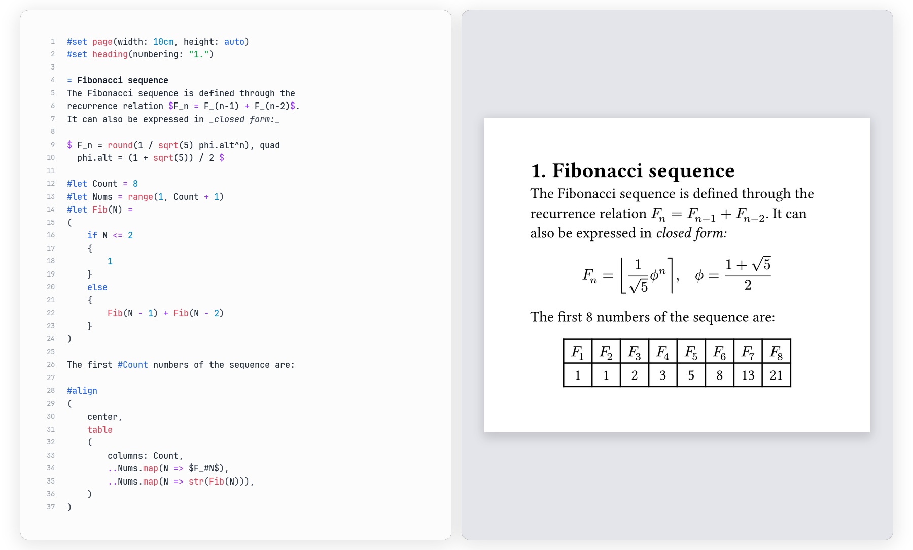

<h1 align="center">
  
</h1>

<p align="center">
  <a href="https://typst.app/docs/">
    </a>
  <a href="https://typst.app/">
    </a>
  <a href="https://discord.gg/2uDybryKPe">
    </a>
  <a href="https://github.com/typst/typst/blob/main/LICENSE">
    </a>
  <a href="https://typst.app/jobs/">
    </a>
</p>

Typst is a new markup-based typesetting system that is designed to be as powerful as LaTeX while being much easier to learn and use. Typst has:

- Built-in markup for the most common formatting tasks
- Flexible functions for everything else
- A tightly integrated scripting system
- Math typesetting, bibliography management, and more
- Fast compile times thanks to incremental compilation
- Friendly error messages in case something goes wrong

This repository contains the Typst compiler and its CLI, which is everything you need to compile Typst documents locally. For the best writing experience,
consider signing up to our [collaborative online editor][app] for free, or launch the included [Typst Studio WebApp](#typst-studio-webapp).

> [!IMPORTANT]
> ### Language-Agnostic Formatting Style (LAFS) & Parser Compatibility Notice
>
> This fork of Typst modifies the syntax parser to ***use*** the **Language-Agnostic Formatting Style (LAFS)** (also known as Allman Style but improved). Delimiter boundaries (`(`, `)`, `{`, `}`, `[`,`]`) maintain strict translational symmetry and coordinate alignment along vertical baselines, permitting detached opening delimiters and container-grouped layouts without syntax errors.
>
> **Notice for Users of Upstream Typst:**
> The official upstream Typst compiler repository ([`typst/typst`](https://github.com/typst/typst)) **does not support** detached delimiters or line breaks preceding block openers (`{`). Compiling LAFS-formatted documents using the standard upstream Typst release will produce parser errors (such as unexpected delimiter or missing block body). Documents formatted with LAFS require the modified compiler binary included in this project (`TypstStudio/bin/typst` or compiled from this repository).

## Example

A [gentle introduction][tutorial] to Typst is available in our documentation. However, if you want to see the power of Typst encapsulated in one image, here it is:

<p align="center">
  
</p>

Let's dissect what's going on:

- We use _set rules_ to configure element properties like the size of pages or the numbering of headings. By setting the page height to `auto`, it scales to fit the content. Set rules accommodate the most common configurations. If you need full control, you can also use [show rules][show] to completely redefine the appearance of an element.
- We insert a heading with the `= Heading` syntax. One equals sign creates a top level heading, two create a subheading and so on. Typst has more lightweight markup like this; see the [syntax][syntax] reference for a full list.
- [Mathematical equations][math] are enclosed in dollar signs. By adding extra spaces around the contents of an equation, we can put it into a separate block. Multi-letter identifiers are interpreted as Typst definitions and functions unless put into quotes. This way, we don't need backslashes for things like `floor` and `sqrt`. And `phi.alt` applies the `alt` modifier to the `phi` to select a particular symbol variant.
- Now, we get to some [scripting][scripting]. To input code into a Typst document, we can write a hash followed by an expression. We define variables (`Count`, `Nums`) and a
  recursive function (`Fib(N)`) formatted according to LAFS to compute the n-th Fibonacci number. Then, we display the results in a center-aligned table. The table function takes its cells row-by-row. Therefore, we first pass the formulas `$F_1$` to `$F_8$` and then the computed Fibonacci numbers. We apply the spreading operator (`..`) to both because they are arrays and we want to pass the arrays' items as individual arguments.

<details>
  <summary>Text version of the code example.</summary>

```typst
#set page(width: 10cm, height: auto)
#set heading(numbering: "1.")

= Fibonacci sequence
The Fibonacci sequence is defined through the
recurrence relation $F_n = F_(n-1) + F_(n-2)$.
It can also be expressed in _closed form:_

$ F_n = round(1 / sqrt(5) phi.alt^n), quad
  phi.alt = (1 + sqrt(5)) / 2 $

#let Count = 8
#let Nums = range(1, Count + 1)
#let Fib(N) =
(
    if N <= 2
    {
        1
    }
    else
    {
        Fib(N - 1) + Fib(N - 2)
    }
)

The first #Count numbers of the sequence are:

#align
(
    center,
    table
    (
        columns: Count,
        ..Nums.map(N => $F_#N$),
        ..Nums.map(N => str(Fib(N))),
    )
)
```

</details>

## Installation

Typst's CLI is available from different sources:

- You can get sources and pre-built binaries for the latest release of Typst from the [releases page][releases]. Download the archive for your platform and place it in a directory that is in your `PATH`. To stay up to date with future releases, you can simply run `typst update`.
- You can install Typst through different package managers. Note that the versions in the package managers might lag behind the latest release.

  - Linux:
    - View [Typst on Repology][repology]
    - View [Typst's Snap][snap]
  - macOS: `brew install typst`
  - Windows: `winget install --id Typst.Typst`
- If you have a [Rust][rust] toolchain installed, you can install

  - the latest released Typst version with
    `cargo install --locked typst-cli`
  - a development version with
    `cargo install --git https://github.com/typst/typst --locked typst-cli`
- Nix users can

  - use the `typst` package with `nix-shell -p typst`
  - build and run the [Typst flake](https://github.com/typst/typst-flake) with
    `nix run github:typst/typst-flake -- --version`.
- Docker users can run a prebuilt image with
  `docker run ghcr.io/typst/typst:latest --help`.

## Usage

Once you have installed Typst, you can use it like this:

```sh
# Creates `file.pdf` in working directory.
typst compile file.typ

# Creates a PDF file at the desired path.
typst compile path/to/source.typ path/to/output.pdf
```

You can also watch source files and automatically recompile on changes. This is faster than compiling from scratch each time because Typst has incremental compilation.

```sh
# Watches source files and recompiles on changes.
typst watch file.typ
```

Typst further allows you to add custom font paths for your project and list all of the fonts it discovered:

```sh
# Adds additional directories to search for fonts.
typst compile --font-path path/to/fonts file.typ

# Lists all of the discovered fonts in the system and the given directory.
typst fonts --font-path path/to/fonts

# Or via environment variable (Linux syntax).
TYPST_FONT_PATHS=path/to/fonts typst fonts
```

For other CLI subcommands and options, see below:

```sh
# Prints available subcommands and options.
typst help

# Prints detailed usage of a subcommand.
typst help watch
```

If you prefer an integrated IDE-like experience with autocompletion and instant preview, you can check out the official [online editor][app] or launch the included offline **Typst Studio WebApp** detailed below. Alternatively, there is a community-created language server called [Tinymist](https://myriad-dreamin.github.io/tinymist/) which is integrated into various editor extensions.

## Typst Studio (Desktop & WebApp)

This repository includes **Typst Studio**, a high-performance, cross-platform local desktop application (powered by Tauri v2 and Rust) and local web environment tailored for authoring and live-previewing Typst documents formatted with LAFS.

### Architecture & Key Features

- **Real-Time Incremental Preview:** Direct integration with the local Typst compiler (`TypstStudio/bin/typst` or native in-process backend) for instantaneous recompilation on keystroke, delivering sub-millisecond document previews via `comemo`.
- **Character-Agnostic 2-State Container Physics (`1D Monolith` ↔ `2D Symmetry`):** Enforces pure LAFS structural container geometry across all delimiters—whether asymmetric `( )`, `{ }`, `[ ]`, `${ }`, `<!-- -->`, `<Tag>...</Tag>` or identical-glyph boundaries `$ ... $`, `` ` ... ` ``, ```` ``` ... ``` ````, `| |`, `$$ $$`, and `""" """`. Pressing `Enter` inside an inline or head-hugging container (e.g., `#table[|]`, `header: context {|}`, `$|$`) detaches the opener and closer onto their own vertically-aligned boundary lines at `baseIndent` while placing the cursor indented inside at `baseIndent + 4` (1D → 2D Symmetrical Detachment). Pressing `Backspace` or `Delete` at container thresholds strictly forbids 1.5D K&R delimiter hugging; if the collapsed container fits within the active canvas limit and meets the complexity budget without internal line comments (`//`), it safely collapses into a clean 1D Monolith with LAFS inner padding; if it breaches the canvas or complexity limit, it executes a hard no-op with zero corruption. Typst labels (`<sec:intro>`, `<eq:rotation>`), arrows (`->`), comparisons (`x > 0`), and closing boundaries are safely skipped. All edits commit as atomic undo steps (`Ctrl+Z`).
- **Independent High-FPS Scrolling & Click-to-Jump SyncTeX:** Code Editor and Preview pane scroll completely independently at native 60 FPS with zero rebound interference or stutter. Explicit bidirectional Click-to-Jump SyncTeX accurately highlights target paragraphs with true inked descender bounds.
- **Sub-Span Byte-Exact SyncTeX & Hierarchical AST Scope Highlighting:** When highlighting a specific substring, word range, or multi-line phrase in the Code Editor, SyncTeX resolves each glyph's exact source byte offset (`[startByte, endByte)`) from the syntax tree rather than collapsing into broad paragraph AST nodes. Matched glyphs are grouped strictly per visual line baseline into tight, non-collapsing per-line bounding boxes with symmetric inked descender clearance (`PadY`, `PadX`), ensuring precise sub-span highlighting without clipping descenders or overflowing at high zoom levels (151%+). Plain cursor clicks automatically resolve the innermost enclosing syntactic artifact (quotes `"..."`, `“...”`, `'...'`, `‘...’`, brackets `[...]`, math `$..$`, code blocks, and emphasis) while cleanly disregarding intra-word apostrophes (`\w['’]\w`) and possessives (`s'`), preventing quotation parity corruption. For table structures (`#table`, `#grid`, etc.), clicking inside a cell or child block highlights that specific cell with a clean geometric bounding box, while clicking configuration arguments or container boundaries highlights the entire container as an integrated union bounding box per page. Non-visual top-level directives (`#set`, `#let`, `#import`, `#show`, `#pagebreak()`) return zero boxes without triggering preview scroll jumps. Cross-page paragraphs spanning consecutive page breaks seamlessly highlight on both pages simultaneously and scroll calmly to the starting page without resetting preview scroll positions.
- **Precision Split-Pane Resizer & Editor Click Stability:** Dragging the resizer between the Code Editor and Preview uses relative pointer delta tracking and pointer capture with strict `min-width: 0; overflow: hidden;` containment, eliminating jump offsets and preventing drag lag regardless of sidebar visibility or document zoom. Mouse clicks and cursor placements inside the editor maintain rock-solid scroll stability without sudden typewriter jumps or line centering jerks.
- **Steve Jobs Ergonomic Status Bar & Left Sidebar Navigation:** The bottom status bar is decluttered to present a calm, distraction-free environment in neutral muted gray (`#8E8E93`). In Focus Mode, only the quiet word count is displayed. The Left Sidebar integrates segmented tabs (`Files | Outline`) allowing instant navigation across project files and document heading hierarchies (`Alt+O`).
- **Segmented Header Navigation & Multi-Document Tabs:** The top bar replaces clumsy dropdowns with a sleek segmented `[ Projects | Editor ]` toggle in the top-left next to the logo. An integrated document tab bar provides frictionless multi-document workflows with individual tab closing (`×`), active document tracking, unsaved change indicators, and instant buffer switching.
- **Dedicated Document Creation Modal:** Replaced native browser prompt dialogs with a keyboard-navigable `#NewDocumentModal` supporting instant creation (`Enter`), dismissal (`Escape`), input auto-selection, target project routing, and inline validation.
- **Dynamic Spread Mode Zoom:** `Fit W` and `Fit Page` zoom calculations dynamically measure dual-page spread geometry and viewport aspect ratios (`0.27` base scale under spread view), preventing zoom locking or dead fit controls.
- **Isolated Keybinding Recorder:** The shortcut recorder in `Edit Keybindings` captures keystrokes with capture-phase priority, immediate event propagation suppression, and a 350ms post-record cooldown to eliminate key leakages into the document editor.
- **Time Machine for Words & Revision Scrubbing:** Native revision milestone snapshots and interactive scrubbing with safety checkpoints, instant diff previews against live buffers, and complete local history restoration. Modals are dismissible via Escape, dedicated close/cancel controls, and backdrop clicks.
- **Immutable LAFS Formatter & Code Box Engine:** Cross-language formatting engine that automatically formats both Typst document syntax and embedded raw code snippets (Rust, C, C++, C#, JavaScript, TypeScript, Kotlin, Dart, Shell) inside `#rect[...]`, `#box[...]`, or raw blocks to the Language-Agnostic Formatting Style (LAFS).
- **Cryptographic Tamper-Proof Binary Invariants:** The formatter engine is hard-locked against substitution and tampering. Every external execution verifies the binary's cryptographic SHA-256 digest (`91faa0ece4e1278ebf2cc58a776de0290e10d31f0d59456410862b52c86067fc`) against pinned release invariants before spawning. If any external binary is tampered with, replaced, or path-traversed, execution is hard-aborted and automatically falls back to the immutable in-process LAFS engine compiled into memory.
- **Air-Gapped & Offline-First:** Formatting and document previewing operate 100% locally with zero internet dependency, zero telemetry, and zero cloud API requirements.
- **Monaco Code Editor:** Full-featured code editor with syntax highlighting for Typst, JetBrains Mono font support, automatic bracket pair colorization, and native Allman/LAFS indentation tiers.
- **Selective Dark Mode:** Dedicated document viewer dark mode that maintains the author's original color palette and embedded figures while selectively inverting monochrome background and foreground layers for high-contrast, comfortable viewing.
- **Workspace Dashboard:** Built-in project tracker and directory scanner that organizes your local `.typ` files, offers one-click project creation, and supports native OS folder picking across Windows, macOS, and Linux.

### Quick Start

To run the compiled native desktop application:

```sh
# Run the release desktop binary
./TypstStudio/src-tauri/target/release/typst-studio.exe
```

Or start the lightweight local web environment:

```sh
# Start the local studio server
node TypstStudio/Server.js
```

Then open your browser to `http://127.0.0.1:3000` to begin editing and previewing your documents.

## Community

The main places where the community gathers are our [Forum][forum] and our [Discord server][discord]. The Forum is a great place to ask questions, help others, and share cool  things you created with Typst. The Discord server is more suitable for quicker questions, discussions about contributing, or just to chat. We'd be happy to see you there!

[Typst Universe][universe] is where the community shares templates and packages. If you want to share your own creations, you can submit them to our [package repository][packages].

If you had a bad experience in our community, please [reach out to us][contact].

## Contributing

We love to see contributions from the community. If you experience bugs, feel free to open an issue. If you would like to implement a new feature or bug fix, please follow the steps outlined in the [contribution guide][contributing].

To build Typst yourself, first ensure that you have the [latest stable Rust][rust] installed. Then, clone this repository and build the CLI with the following commands:

```sh
git clone https://github.com/typst/typst
cd typst
cargo build --release
```

The optimized binary will be stored in `target/release/`.

Another good way to contribute is by [sharing packages][packages] with the
community.

## Pronunciation and Spelling

IPA: /taɪpst/. "Ty" like in **Ty**pesetting and "pst" like in Hi**pst**er. When writing about Typst, capitalize its name as a proper noun, with a capital "T".

## Design Principles

All of Typst has been designed with three key goals in mind: Power, simplicity, and performance. We think it's time for a system that matches the power of LaTeX, is easy to learn and use, all while being fast enough to realize instant preview. To achieve these goals, we follow three core design principles:

- **Simplicity through Consistency:**
  If you know how to do one thing in Typst, you should be able to transfer that knowledge to other things. If there are multiple ways to do the same thing, one of them should be at a different level of abstraction than the other. E.g. it's okay that `= Introduction` and `#heading[Introduction]` do the same thing because the former is just syntax sugar for the latter.
- **Power through Composability:**
  There are two ways to make something flexible: Have a knob for everything or have a few knobs that you can combine in many ways. Typst is designed with the second way in mind. We provide systems that you can compose in ways we've never even thought of. TeX is also in the second category, but it's a bit low-level and therefore people use LaTeX instead. But there, we don't really have that much composability. Instead, there's a package for everything
  (`\usepackage{knob}`).
- **Performance through Incrementality:**
  All Typst language features must accommodate for incremental compilation. Luckily we have , a system for incremental compilation which does most of the hard work in the background.

## Acknowledgements

We'd like to thank everyone who is supporting Typst's development, be it via [GitHub sponsors][GitHub sponsors] or elsewhere. In particular, special thanks[^1] go to:

- [Posit](https://posit.co/blog/posit-and-typst/) for financing a full-timecompiler engineer
- [NLnet](https://nlnet.nl/) for supporting work on Typst via multiple grants through the [NGI Zero Core](https://nlnet.nl/core) fund:
  - Work on [HTML export](https://nlnet.nl/project/Typst-HTML/)
  - Work on [PDF accessibility](https://nlnet.nl/project/Typst-Accessibility/)
- [Science &amp; Startups](https://www.science-startups.berlin/) for having financed Typst development from January through June 2023 via the Berlin Startup Scholarship
- [Zerodha](https://zerodha.tech/blog/1-5-million-pdfs-in-25-minutes/) for their generous one-time sponsorship

[docs]: https://typst.app/docs/
[app]: https://typst.app/
[discord]: https://discord.gg/2uDybryKPe
[forum]: https://forum.typst.app/
[universe]: https://typst.app/universe/
[tutorial]: https://typst.app/docs/tutorial/
[show]: https://typst.app/docs/reference/styling/#show-rules
[math]: https://typst.app/docs/reference/math/
[syntax]: https://typst.app/docs/reference/syntax/
[scripting]: https://typst.app/docs/reference/scripting/
[rust]: https://rustup.rs/
[releases]: https://github.com/typst/typst/releases/
[repology]: https://repology.org/project/typst/versions
[contact]: https://typst.app/contact
[architecture]: https://github.com/typst/typst/blob/main/docs/dev/architecture.md
[contributing]: https://github.com/typst/typst/blob/main/CONTRIBUTING.md
[packages]: https://github.com/typst/packages/
[`comemo`]: https://github.com/typst/comemo/
[snap]: https://snapcraft.io/typst
[GitHub sponsors]: https://github.com/sponsors/typst/
[^1]: This list only includes contributions for our open-source work that exceed
       or are expected to exceed €10K.
